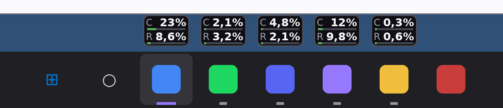
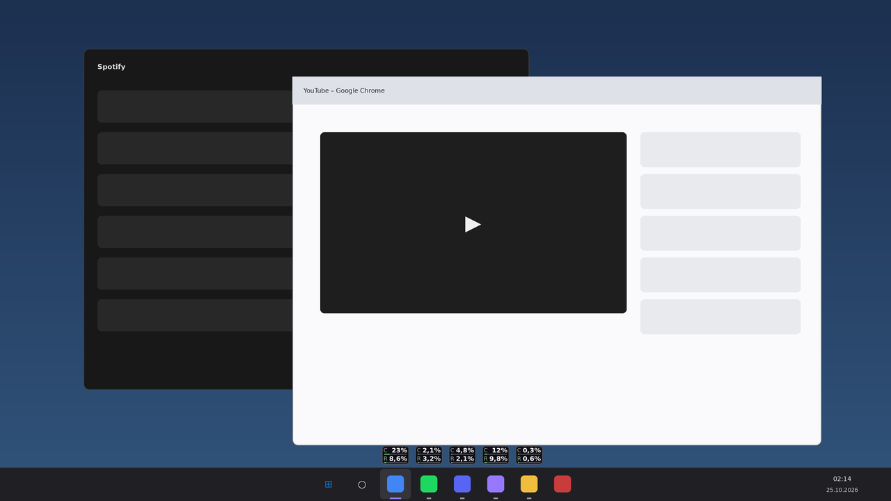
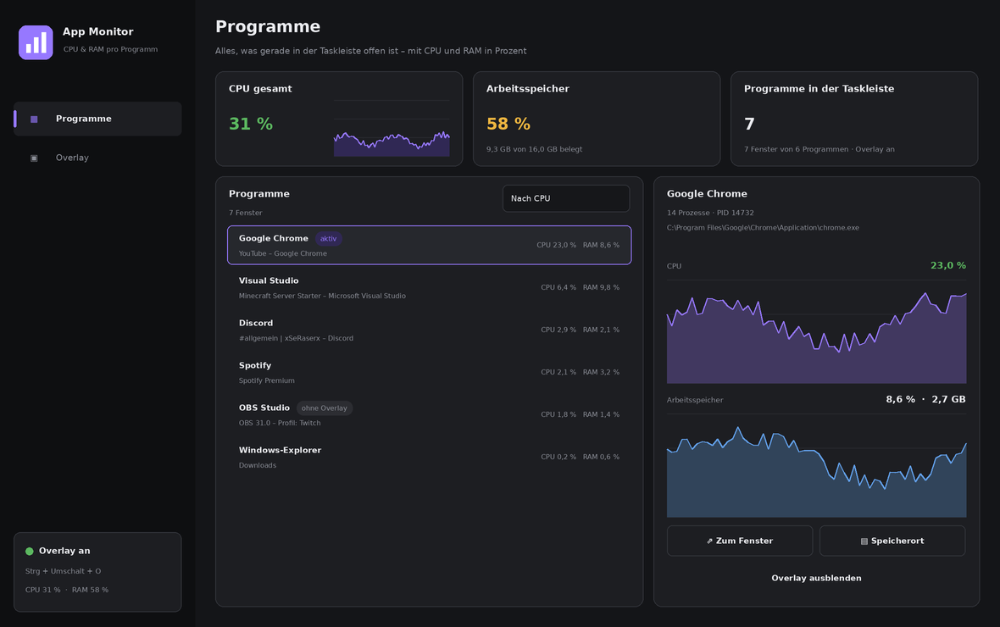

# App Monitor

von **[FGSeRaser](https://github.com/FGSeRaser)**

Zeigt für jedes Programm in der Taskleiste die **CPU- und RAM-Auslastung in Prozent**, direkt **über den App-Symbolen in der Taskleiste**. Wahlweise erscheint die Anzeige auch als Overlay im Programmfenster.

## Funktionen

- **Erkennt Taskleisten-Programme** nach denselben Regeln wie Windows: sichtbare Hauptfenster ohne Tool-Fenster und ohne versteckte Fenster. UWP-Apps wie Rechner oder Einstellungen werden ebenfalls erkannt.
- **Alle Prozesse eines Programms zusammen:** Chrome, Edge, Discord und andere Programme laufen mit vielen Hilfsprozessen. Die werden mitgezählt, z. B. „Google Chrome · 14 Prozesse“.
- **CPU %** wird wie im Task-Manager berechnet, also bezogen auf alle Kerne.
- **RAM %** bezieht sich auf den gesamten Arbeitsspeicher. Gezählt wird der private Arbeitssatz, zusätzlich wird die Größe in MB/GB angezeigt.
- **Anzeige in der Taskleiste (Standard):**
  - Jedes App-Symbol bekommt ein kleines Schild mit CPU % und RAM %.
  - Position wählbar: über der Taskleiste, unten auf dem Symbol oder oben auf dem Symbol.
  - Inhalt wählbar: CPU und RAM, nur CPU oder nur RAM.
  - Funktioniert mit Windows 10 und 11, mit mehreren Monitoren und mit Taskleisten oben, links oder rechts. Die Symbole werden per UI Automation gefunden.
  - Bei ausgeblendeter Taskleiste (automatisch ausblenden) oder bei Vollbild-Programmen verschwindet die Anzeige.
- **Overlay im Programmfenster (optional):**
  - nur im aktiven Fenster oder in allen sichtbaren Fenstern
  - Ecke wählbar
  - CPU-Verlauf ein- oder ausschaltbar
  - Deckkraft einstellbar
  - Mausklicks gehen durch das Overlay hindurch, es stört also nicht.
  - Das Overlay wandert mit, wenn du das Fenster verschiebst, und funktioniert auch auf Monitoren mit unterschiedlicher Skalierung.
- **Strg + Umschalt + O** schaltet das Overlay überall ein und aus.
- **Seite „Programme“:**
  - Liste aller offenen Programme, sortierbar nach CPU, RAM oder Name
  - Verlaufsgraphen für jedes Programm
  - „Zum Fenster“ und „Speicherort“
  - Overlay für einzelne Programme ausblenden
- **Infobereich und Autostart:** Beim Schließen läuft App Monitor im Infobereich weiter. Optional startet es mit Windows (unsichtbar im Infobereich).

## Bauen

1. ZIP **entpacken**.
2. `App Monitor.sln` in Visual Studio 2019/2022 öffnen.
3. Starten mit F5. Das Projekt nutzt .NET Framework 4.8 und keine NuGet-Pakete.

Die Einstellungen liegen unter `%AppData%\App Monitor\settings.json`.

## Hinweise

- Spiele im **exklusiven Vollbild** zeigen keine fremden Fenster. Dort ist das Overlay nicht sichtbar. Im Modus **„Randloses Fenster / Borderless“** funktioniert es.
- Programme, die als Administrator laufen, werden gemessen. Damit das Overlay über ihnen liegt, muss App Monitor aber ebenfalls als Administrator gestartet werden.

## Autor

Entwickelt von **FGSeRaser**. Weitere Projekte gibt es auf GitHub: [github.com/FGSeRaser](https://github.com/FGSeRaser)

Im Programm findest du den Link unten in der Seitenleiste („von FGSeRaser“).
